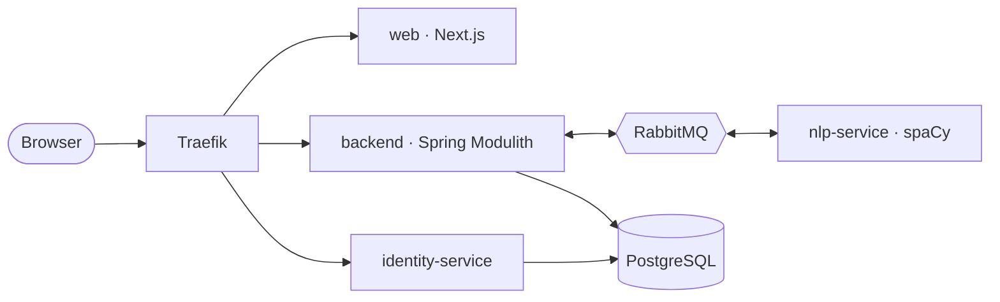

# lyricsync

Learn German through music. Lyrics light up line by line as the song plays, every word can be tapped for its meaning, base form and gender, and saved words come back in spaced-repetition reviews that replay the exact line you heard them in.

> **Status:** in development. The ingestion backend works; the player, NLP pipeline and accounts are next. See the [roadmap](docs/PROJECT_SPEC.md#12-roadmap).

## Highlights

- **Synced lyrics** from `.lrc` files, with loop-line and slow-down (pitch preserved)
- **Tap any word**: lemma (`ging → gehen`), word type, der/die/das colour coding, separable verbs (`rufe … an → anrufen`)
- **Reviews with the song's own audio**, scheduled with FSRS
- **CEFR levels A1–B2**, guest mode, streaks
- **Runs for about €8.50 a month**: one VPS, everything else on free tiers

## Architecture

A Spring Modulith backend (catalog, dictionary and learning modules), a separate identity service, a Python NLP service with spaCy, and a Next.js web app, connected through RabbitMQ and fronted by Traefik.



More detail:
- [Architecture overview](docs/ARCHITECTURE.md)
- [Project spec](docs/PROJECT_SPEC.md)
- [Architecture decision records](docs/adr/)
- [Glossary](GLOSSARY.md)
- [Development log](docs/DEVLOG.md)

## Tech stack

| Area | Tools |
|---|---|
| Backend | Java 21, Spring Boot 4, Spring Modulith, Spring Data JPA, Flyway, PostgreSQL |
| NLP | Python, FastAPI, spaCy |
| Web | Next.js, TypeScript, Tailwind, shadcn/ui, TanStack Query |
| Messaging | RabbitMQ |
| Testing | JUnit 5, Testcontainers, ArchUnit, pytest, Vitest, Playwright |
| Ops | Docker, Traefik, GitHub Actions, GHCR, Grafana Cloud; k3s + Argo CD planned |

## Running locally

Requirements: Docker and JDK 21.

```bash
cd backend
./mvnw verify            # unit + Testcontainers integration tests
./mvnw spring-boot:run   # starts Postgres via Docker Compose, then the app
```

A single `docker compose up` for the whole stack is coming in OPS-2.4.

## Credits

Dictionary data: [Wiktionary](https://www.wiktionary.org/) via [kaikki.org](https://kaikki.org/) (CC BY-SA).
