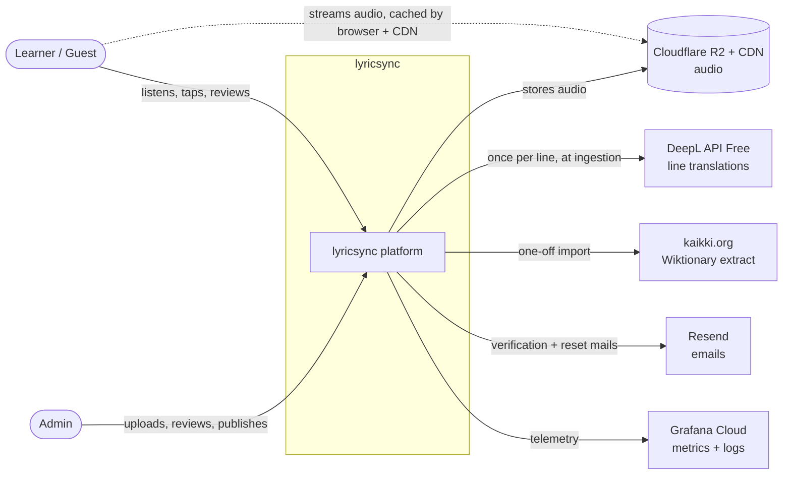
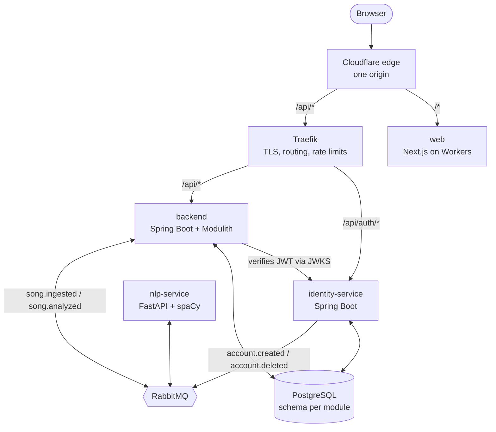
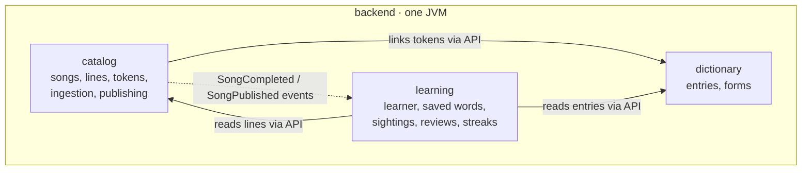
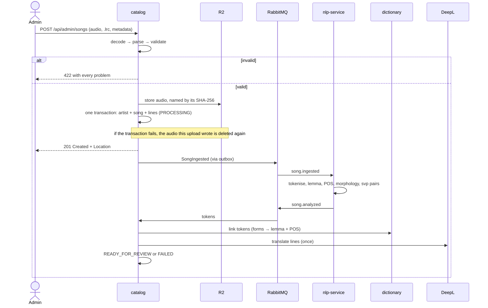
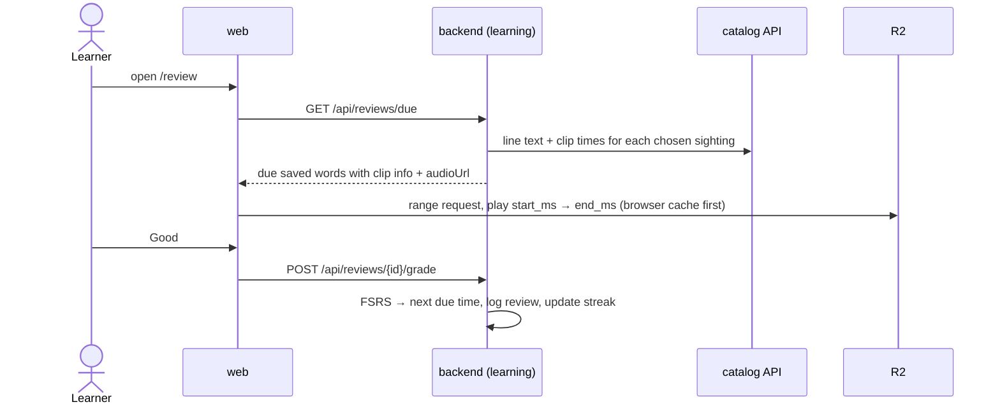
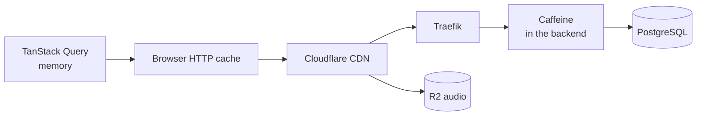
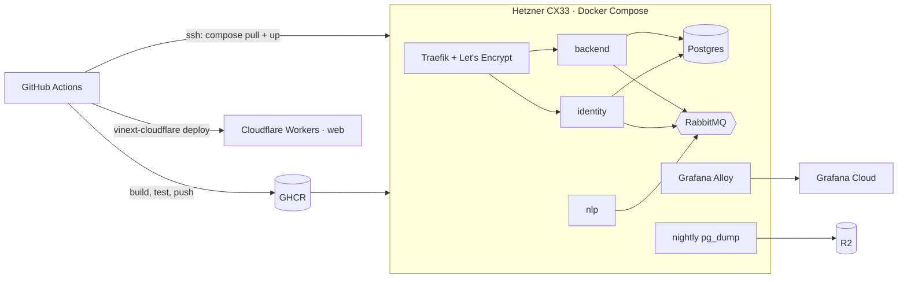

# Architecture

How lyricsync is put together. The why behind each choice is in [docs/adr](adr/); the words used here are defined in [GLOSSARY.md](../GLOSSARY.md).

## 1. System context



Learners never cause a call to DeepL or kaikki.org; those run only during ingestion or import ([ADR-0010](adr/0010-no-external-calls-at-runtime.md)).

## 2. Apps



| App | Owns | Talks to |
|---|---|---|
| `web` | All UI, guest data in the browser; runs on Cloudflare Workers ([ADR-0012](adr/0012-web-on-cloudflare-workers.md)) | backend and identity through the same origin (`/api/*`) |
| `backend` | catalog, dictionary and learning modules | Postgres, RabbitMQ, R2, DeepL |
| `identity-service` | Accounts, passwords, tokens, verification mails | Postgres, RabbitMQ, Resend |
| `nlp-service` | Tokens, lemmas, morphology, separable verbs | RabbitMQ only (stateless) |

## 3. Inside the backend



Every module has the same internal shape:

```
<module>/
├── domain/        pure Java: records, rules, no Spring or JPA
├── application/   use cases + ports (in: what the module offers, out: what it needs)
├── adapter/
│   ├── in/        web controllers, message listeners
│   └── out/       JPA, R2, DeepL, RabbitMQ
└── config/        wiring
```

Rules ([ADR-0002](adr/0002-modular-monolith.md)):
- A module owns its Postgres schema; no foreign keys cross schemas.
- Only a module's top-level package is its public API; sub-packages are internal.
- Queries go through public APIs, state changes travel as events. Events between modules go through the Modulith event publication registry, a transactional outbox, so they survive crashes.
- Two tests fail the build when a rule is broken: `ModularityTest` (`ApplicationModules.verify()`, module boundaries) and `HexagonalArchitectureTest` (ArchUnit, layers inside each module). The domain may depend only on the JDK and its own domain packages.
- `./mvnw verify` also writes module diagrams and canvases (PlantUML, AsciiDoc) to `backend/target/spring-modulith-docs`.

## 4. Ingestion



Audio goes to storage before the database transaction, so no database locks are held during slow I/O. If the process dies between the two steps, an unreferenced file is left behind; that's harmless (nothing points at it), and a later clean-up job can sweep such files. Re-delivering a message replaces the song's tokens, so the pipeline is safe to retry. Messages that keep failing land in a dead-letter queue, and the song shows FAILED with the reason.

## 5. Review



## 6. Caching

Rule of thumb: cache what is shared and rarely changes as close to the learner as possible; never cache one learner's data on the server ([ADR-0011](adr/0011-caching-strategy.md)).



| Request | First hit that answers it |
|---|---|
| Back to a song in the same session | TanStack Query (no request) |
| The song's MP3 again, any time | Browser cache (immutable, content-hashed URL) |
| Song JSON after a reload | Browser revalidates with `ETag` and gets `304 Not Modified` |
| Song JSON for another learner | Cloudflare CDN |
| First request after a publish | Caffeine, then PostgreSQL once |
| Due reviews, saved words, streak | Always the backend and database (`private, no-store`) |

`SongPublished`, `SongReanalysed` and `SongUnpublished` events clear the affected Caffeine entries and bump the song's version, which changes its `ETag`.

## 7. Authentication

- identity-service issues a short-lived RS256 access token and a rotating refresh token, both as httpOnly, `SameSite=Lax` cookies on the app's own domain ([ADR-0006](adr/0006-own-identity-service.md)).
- The backend validates tokens against identity's JWKS endpoint, checks the `ADMIN` role for admin routes, and never sees passwords.
- `AccountCreated` creates the learner; `AccountDeleted` removes all learner data ([ADR-0009](adr/0009-account-and-learner.md)).

## 8. Deployment

**v1: Docker Compose on one VPS** ([ADR-0003](adr/0003-compose-first-kubernetes-later.md))



**Stretch: single-node k3s.** Same images; Argo CD syncs Kustomize manifests from the repo, CloudNativePG runs Postgres with backups to R2, cert-manager handles certificates, and Sealed Secrets keeps secrets in git.

## 9. Repository layout

```
/
├── backend/            Spring Boot + Modulith
├── identity-service/   (Sprint 5)
├── nlp-service/        (Sprint 4)
├── web/                (Sprint 3)
├── docs/               spec, architecture, ADRs, devlog
├── compose.yaml        local stack (OPS-2.4)
└── GLOSSARY.md
```
